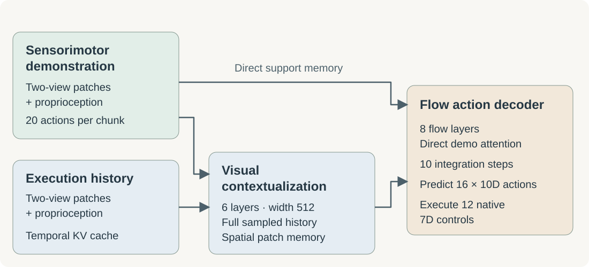

# FPP · Full-History Patch Policy on LIBERO-Gen

FPP performs demonstration-conditioned manipulation without test-time parameter updates. A sensorimotor demonstration specifies the task; a block-causal Transformer retains the complete sampled execution history as spatial patches. A flow-matching action decoder attends to the current contextualized observation and directly to the demonstration.

[Method article](https://ycma8.github.io/fpp-libero-gen-icl/) · [Reproduce](docs/REPRODUCING.md) · [Result records](results/reference/) · [Code map](docs/CODE_MAP.md)

## Results

LIBERO-Gen Combination: ten held-out tasks, fifty official initial states per task.

| Policy / condition | Successes | Success rate |
|---|---:|---:|
| **FPP, correct demonstration** | **391/500** | **78.2%** |
| FPP, wrong-task demonstration | 51/500 | 10.2% |
| Released BPP reference, seed 2 | 391/500 | 78.2% |

FPP matches the released BPP reference point estimate; it does **not** exceed it. The wrong-demonstration control uses the same FPP checkpoint and matched states/seeds, supporting overall prompt dependence without isolating individual modalities. This is one fresh policy training seed. Checkpoint/EMA selection was informed by benchmark evaluations; these results do not establish statistical superiority, an optimal budget, or a matched-compute architecture comparison.

Verify all 1,000 supplied FPP trial records with Python's standard library:

```bash
python3 scripts/verify_results.py
```

Trial and summary files retain their original bytes. Machine-specific checkpoint paths were replaced only in protocol metadata; export provenance records that transformation and original hashes. Verification checks recorded outcomes and identities; it does not replay the simulator. Model weight binaries are not currently hosted; their fingerprints are published in [provenance.json](results/reference/provenance.json).

## Method



- **Inputs:** support dual-view RGB, 20-action chunks and 11D proprioception; query dual-view RGB, proprioception and complete sampled past history. No task IDs, language or privileged object states enter the policy.
- **Visual memory:** frozen DINOv3 ViT-B/16 produces 14×14 patches. Support images retain all patches. Query agent images retain 196 patches; wrist images use learned 49-token pooling. Six width-512 visual layers contextualize a bidirectional demonstration prefix and a block-causal execution history.
- **Actions:** eight width-512 flow layers predict 16×10D action chunks, with independent masked demo cross-attention in every layer. Demo K/V projections are shared across training target times with gradients preserved. Action Q/K normalization and FP32 residuals improve numerical stability.
- **Inference:** temporal KV caching retains up to 46 sampled observations. Ten flow integration steps generate a chunk; the official wrapper executes twelve native 7D controls at 20Hz before the next observation.
- **Training:** all 8,200 trajectories from 164 training tasks, global batch 64, fresh policy/AdamW/EMA at seed 42. Query states use fixed stride 12 and next-action alignment. Every sample pairs distinct same-task query/support trajectories. This release does not claim full-frame query supervision.

The reported policy uses 10,000 optimizer updates with the **50K cosine schedule retained**, 2K warmup, peak LR 2e-4, AdamW betas (0.9, 0.95), weight decay 0.01 and gradient clipping 1.0. Constant FP32 EMA (0.999) starts at step 2K. No earlier robot-policy checkpoint is loaded; the generic DINO visual backbone is pretrained and frozen. [Full configuration](configs/reference.json).

## Install

Use Python 3.10+ and install CUDA PyTorch for your machine first:

```bash
python3 -m venv .venv
source .venv/bin/activate
python -m pip install -e '.[dev]'
OMP_NUM_THREADS=1 MKL_NUM_THREADS=1 python -m pytest -q
```

Long-context execution requires CUDA FlexAttention. CPU supports the supplied unit tests and offline result verification. The reported runtime used PyTorch 2.7.1/CUDA 12.8, timm 1.0.28, NumPy 1.26.4, h5py 3.16.0, MuJoCo 3.3.0, robosuite 1.4.0 and gym 0.21.0. Install the pinned external BPP/LIBERO simulation environment separately; see [reproduction](docs/REPRODUCING.md).

## Prepare, train and evaluate

Obtain the [official Combination data](https://huggingface.co/datasets/austinpatel/libero_gen_spatial_combination_hdf5), pinned DINO weights and BPP/LIBERO assets. [Preparation instructions](docs/REPRODUCING.md) build base, sensorimotor-demo and query sidecar caches from training-only normalization statistics.

```bash
torchrun --standalone --nproc_per_node=8 train.py \
  --data-root /datasets/fpp/base \
  --demo-cache-root /datasets/fpp/demo \
  --execution-cache-root /datasets/fpp/execution \
  --output outputs/fpp-seed42 --source-revision "$(git rev-parse HEAD)"
```

`train.py` supplies the reported method and recipe defaults. `--batch` is global. An explicit `--resume` is for interrupted runs only; it restores optimizer/EMA state, while sampler/RNG restart is not bitwise replay. It is not used by the reported fresh initialization.

```bash
MUJOCO_GL=egl MUJOCO_EGL_DEVICE_ID=0 python evaluate.py \
  --checkpoint outputs/fpp-seed42/step_010000.pt \
  --data-root /datasets/fpp/base --demo-cache-root /datasets/fpp/demo \
  --execution-cache-root /datasets/fpp/execution --raw-root /datasets/libero-gen \
  --bpp-root /repos/behavior_prompting --libero-root /repos/LIBERO \
  --dino-checkpoint /models/dinov3/model.safetensors \
  --shard 0 --shards 8 --output outputs/eval-correct \
  --source-revision "$(git rev-parse HEAD)"
```

Run all eight logical shards to cover all 500 trials; a single shard is not a full score. `evaluate.py` selects EMA by default. See the reproduction guide for parallel execution and aggregation.

## Repository layout

| Path | Purpose |
|---|---|
| `fpp_libero_gen/` | Demonstration-conditioned model, dataset, EMA and official runtime |
| `fpp_libero_mem/` | Shared FPP attention, RoPE, normalization and distributed primitives |
| `train.py`, `evaluate.py` | Method-default training and official evaluation entry points |
| `prepare_*.py` | Reference-compatible feature and sensorimotor preparation |
| `configs/` | Reported recipe and pinned dataset source identities |
| `results/reference/` | Correct/wrong prompt records, canonical identities and provenance |
| `tests/` | Model, modality, cache, distributed and release checks |
| `article/` | Standalone method article using the research-article-template layout |

## Attribution and license

First-party code is MIT licensed. This implementation builds on [FPP on LIBERO-Mem](https://github.com/ycma8/fpp-libero-mem), [BPP/LIBERO-Gen](https://github.com/real-stanford/behavior_prompting), LIBERO and DINOv3. External weights, datasets and simulator assets retain their own terms and are not included. The article template retains its CC BY 4.0 attribution. See [third-party notices](THIRD_PARTY_NOTICES.md) and [citation](CITATION.cff).
